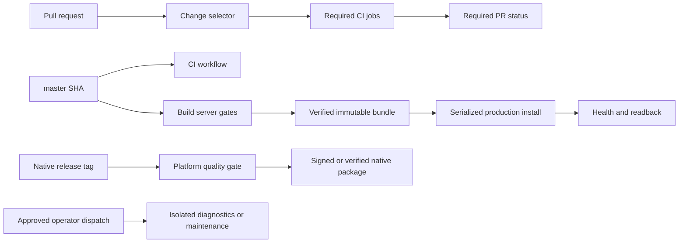

# CI/CD baseline

Generated: 2026-10-18T16:22:31Z

Repository: Egkurilov/BOOHTACORD

## Reproduce

From the repository root, provide GH_TOKEN or GITHUB_TOKEN with read access and run:

    python3 -m tools.ci.baseline.run --repo Egkurilov/BOOHTACORD --sample-size 30 --date 2026-10-18

The collector uses read-only GitHub API requests and does not download job logs or artifact contents.

This run-level baseline uses GitHub Actions metadata. Workflow wall-clock and summed runner-minutes are separate measures. The sample includes completed runs; cancellations remain visible as conclusions.

Changed-component labels for every sample are in the machine-readable report. PR runs use the associated pull request file list; push and tag runs use the head commit file list. Missing file data is labeled unknown.

## Sample coverage

| Population | Requested | Available | Success | Failed | Failure rate | Cancelled | Retries |
| --- | ---: | ---: | ---: | ---: | ---: | ---: | ---: |
| PR required CI | 30 | 30 | 15 | 1 | 3.3% | 14 | 1 |
| master CI | 30 | 30 | 26 | 2 | 6.7% | 2 | 0 |
| master Build server | 30 | 30 | 30 | 0 | 0.0% | 0 | 0 |
| production deploy | 30 | 30 | 23 | 0 | 0.0% | 7 | 0 |
| Android release | 30 | 27 | 18 | 7 | 25.9% | 2 | 0 |
| Windows release | 30 | 14 | 11 | 3 | 21.4% | 0 | 1 |
| macOS release | 30 | 0 | 0 | 0 | N/A | 0 | 0 |

## Timing and runner use

| Population | n | elapsed p50 | elapsed p95 | successful p95 | runner minutes total |
| --- | ---: | ---: | ---: | ---: | ---: |
| PR required CI | 30 | 20.22 min | 28.33 min | 55.27 min | 1667.70 |
| master CI | 30 | 19.75 min | 26.80 min | 26.80 min | 1821.77 |
| master Build server | 30 | 18.07 min | 24.27 min | 24.27 min | 828.42 |
| production deploy | 30 | 1.65 min | 20.38 min | 13.17 min | 244.23 |
| Android release | 27 | 21.57 min | 39.70 min | 32.20 min | 1939.78 |
| Windows release | 14 | 11.17 min | 16.03 min | 16.03 min | 147.90 |
| macOS release | 0 | N/A | N/A | N/A | 0.00 |

GitHub reports 1045 completed push runs; the API returned 1000 in 11 pages. Native-release counts are lower bounds for the history returned by this endpoint.

## Run samples

| Population | Latest | Slowest sampled run | First non-success |
| --- | --- | --- | --- |
| PR required CI | [39138097085](https://github.com/Egkurilov/BOOHTACORD/actions/runs/39138097085) | [39114978959](https://github.com/Egkurilov/BOOHTACORD/actions/runs/39114978959) | [39130446540](https://github.com/Egkurilov/BOOHTACORD/actions/runs/39130446540) |
| master CI | [39140639128](https://github.com/Egkurilov/BOOHTACORD/actions/runs/39140639128) | [39074414160](https://github.com/Egkurilov/BOOHTACORD/actions/runs/39074414160) | [39122851390](https://github.com/Egkurilov/BOOHTACORD/actions/runs/39122851390) |
| master Build server | [39140639113](https://github.com/Egkurilov/BOOHTACORD/actions/runs/39140639113) | [39133279357](https://github.com/Egkurilov/BOOHTACORD/actions/runs/39133279357) | N/A |
| production deploy | [39142390024](https://github.com/Egkurilov/BOOHTACORD/actions/runs/39142390024) | [39035633700](https://github.com/Egkurilov/BOOHTACORD/actions/runs/39035633700) | [39112778777](https://github.com/Egkurilov/BOOHTACORD/actions/runs/39112778777) |
| Android release | [38483584503](https://github.com/Egkurilov/BOOHTACORD/actions/runs/38483584503) | [36828830704](https://github.com/Egkurilov/BOOHTACORD/actions/runs/36828830704) | [38483584503](https://github.com/Egkurilov/BOOHTACORD/actions/runs/38483584503) |
| Windows release | [38483751676](https://github.com/Egkurilov/BOOHTACORD/actions/runs/38483751676) | [38456019824](https://github.com/Egkurilov/BOOHTACORD/actions/runs/38456019824) | [38483751676](https://github.com/Egkurilov/BOOHTACORD/actions/runs/38483751676) |

PR time to required green grouped by source commit: 15 successful cohorts from 30 sampled runs, p50=23.83 min, p95=55.27 min; 0 had a non-success before green and 15 had no successful run in the sample.

## Measured job hotspots

| Population | Job | n | p50 | p95 |
| --- | --- | ---: | ---: | ---: |
| PR required CI | windows / windows | 30 | 18.92 min | 26.78 min |
| PR required CI | frontend / frontend | 30 | 16.88 min | 21.38 min |
| PR required CI | flutter / flutter | 30 | 17.10 min | 18.30 min |
| PR required CI | backend / backend | 30 | 7.42 min | 8.05 min |
| PR required CI | contracts / contracts | 30 | 1.30 min | 1.58 min |
| master CI | windows / windows | 30 | 19.35 min | 26.57 min |
| master CI | frontend / frontend | 30 | 15.68 min | 21.55 min |
| master CI | flutter / flutter | 30 | 17.37 min | 20.55 min |
| master CI | backend / backend | 30 | 7.83 min | 8.10 min |
| master CI | contracts / contracts | 30 | 1.33 min | 1.52 min |
| master Build server | web / frontend | 30 | 15.80 min | 21.22 min |
| master Build server | backend / backend | 30 | 7.53 min | 8.07 min |
| master Build server | bundle | 30 | 2.37 min | 4.07 min |
| master Build server | contracts / contracts | 30 | 1.63 min | 1.88 min |

Measured required PR hotspots: windows / windows (p95 26.78 min), frontend / frontend (p95 21.38 min), flutter / flutter (p95 18.30 min). Master CI and Build server both ran backend, contracts, frontend jobs; quantify their repeated runner work before changing coverage. Start optimization analysis with the measured hotspots, then compare runner-minute savings with required-green p95.

## Delivery path evidence

| Source SHA | Build run | Deploy run | Master to artifact | Artifact to health |
| --- | --- | --- | ---: | ---: |
| 41d44f1099e5 | [build](https://github.com/Egkurilov/BOOHTACORD/actions/runs/39140639113) | [deploy](https://github.com/Egkurilov/BOOHTACORD/actions/runs/39142390024) | 23.25 min | 16.88 min |
| dc1ae43cab45 | [build](https://github.com/Egkurilov/BOOHTACORD/actions/runs/39136769874) | [deploy](https://github.com/Egkurilov/BOOHTACORD/actions/runs/39138266733) | 20.33 min | 12.32 min |
| a6366b570a10 | [build](https://github.com/Egkurilov/BOOHTACORD/actions/runs/39133279357) | [deploy](https://github.com/Egkurilov/BOOHTACORD/actions/runs/39135171908) | 25.35 min | 7.02 min |
| 7c0d15a597ee | [build](https://github.com/Egkurilov/BOOHTACORD/actions/runs/39122851369) | [deploy](https://github.com/Egkurilov/BOOHTACORD/actions/runs/39124450547) | 23.70 min | 7.13 min |
| 9e6a39eaeb74 | [build](https://github.com/Egkurilov/BOOHTACORD/actions/runs/39118751347) | [deploy](https://github.com/Egkurilov/BOOHTACORD/actions/runs/39120347492) | 24.13 min | 11.28 min |
| becda60d009a | [build](https://github.com/Egkurilov/BOOHTACORD/actions/runs/39114584975) | [deploy](https://github.com/Egkurilov/BOOHTACORD/actions/runs/39115775900) | 18.02 min | 13.22 min |
| 5eb564ff3f47 | [build](https://github.com/Egkurilov/BOOHTACORD/actions/runs/39107796184) | [deploy](https://github.com/Egkurilov/BOOHTACORD/actions/runs/39109264610) | 23.27 min | 7.15 min |
| 1557cfce4330 | [build](https://github.com/Egkurilov/BOOHTACORD/actions/runs/39103770348) | [deploy](https://github.com/Egkurilov/BOOHTACORD/actions/runs/39105123951) | 22.82 min | 1.20 min |
| c8d46934d1df | [build](https://github.com/Egkurilov/BOOHTACORD/actions/runs/39074414133) | [deploy](https://github.com/Egkurilov/BOOHTACORD/actions/runs/39076027620) | 23.62 min | 1.08 min |
| 59e96ee051d6 | [build](https://github.com/Egkurilov/BOOHTACORD/actions/runs/39071010271) | [deploy](https://github.com/Egkurilov/BOOHTACORD/actions/runs/39072697012) | 24.27 min | 1.20 min |
| 16e5971c7378 | [build](https://github.com/Egkurilov/BOOHTACORD/actions/runs/39068696729) | [deploy](https://github.com/Egkurilov/BOOHTACORD/actions/runs/39070001809) | 18.48 min | 1.63 min |
| 332ef84ae536 | [build](https://github.com/Egkurilov/BOOHTACORD/actions/runs/39065987368) | [deploy](https://github.com/Egkurilov/BOOHTACORD/actions/runs/39067629913) | 23.20 min | 1.68 min |
| 622d68fc7663 | [build](https://github.com/Egkurilov/BOOHTACORD/actions/runs/39062915381) | [deploy](https://github.com/Egkurilov/BOOHTACORD/actions/runs/39064432669) | 21.42 min | 1.53 min |
| 9dc315922034 | [build](https://github.com/Egkurilov/BOOHTACORD/actions/runs/39009853397) | [deploy](https://github.com/Egkurilov/BOOHTACORD/actions/runs/39010845889) | 16.00 min | 1.22 min |
| 979d0bd0631e | [build](https://github.com/Egkurilov/BOOHTACORD/actions/runs/38971542853) | [deploy](https://github.com/Egkurilov/BOOHTACORD/actions/runs/38973456693) | 18.07 min | 1.13 min |
| 1784d2cd209e | [build](https://github.com/Egkurilov/BOOHTACORD/actions/runs/38960247632) | [deploy](https://github.com/Egkurilov/BOOHTACORD/actions/runs/38962233574) | 16.25 min | 1.42 min |
| 4cda8f5c464e | [build](https://github.com/Egkurilov/BOOHTACORD/actions/runs/38945566810) | [deploy](https://github.com/Egkurilov/BOOHTACORD/actions/runs/38947478044) | 14.77 min | 1.47 min |
| 2ee7e9ec6268 | [build](https://github.com/Egkurilov/BOOHTACORD/actions/runs/38902955398) | [deploy](https://github.com/Egkurilov/BOOHTACORD/actions/runs/38924339892) | 15.00 min | 157.42 min |
| efdb4b04597d | [build](https://github.com/Egkurilov/BOOHTACORD/actions/runs/38883259447) | [deploy](https://github.com/Egkurilov/BOOHTACORD/actions/runs/38884918821) | 14.65 min | 1.35 min |
| aa264a74c250 | [build](https://github.com/Egkurilov/BOOHTACORD/actions/runs/38876715637) | [deploy](https://github.com/Egkurilov/BOOHTACORD/actions/runs/38878302514) | 13.98 min | 1.18 min |
| c6e789bb39b2 | [build](https://github.com/Egkurilov/BOOHTACORD/actions/runs/38866233063) | [deploy](https://github.com/Egkurilov/BOOHTACORD/actions/runs/38867385476) | 10.87 min | 1.27 min |
| 6b1225bf24c4 | [build](https://github.com/Egkurilov/BOOHTACORD/actions/runs/38859041734) | [deploy](https://github.com/Egkurilov/BOOHTACORD/actions/runs/38860255218) | 12.88 min | 1.30 min |
| 3e6ac9636065 | [build](https://github.com/Egkurilov/BOOHTACORD/actions/runs/38588663770) | [deploy](https://github.com/Egkurilov/BOOHTACORD/actions/runs/38590707600) | 13.72 min | 1.23 min |

## Artifact activity

| Population | Runs with artifact metadata | Artifacts | Size total | Upload/retain steps | Download steps | API download count |
| --- | ---: | ---: | ---: | ---: | ---: | ---: |
| PR required CI | 30 | 520 | 5100.91 MB | 771 | 0 | N/A |
| master CI | 30 | 540 | 6629.56 MB | 640 | 0 | N/A |
| master Build server | 30 | 486 | 2881.77 MB | 486 | 30 | N/A |
| production deploy | 30 | 0 | 0.00 MB | 0 | 30 | N/A |
| Android release | 27 | 57 | 3490.32 MB | 68 | 0 | N/A |
| Windows release | 14 | 11 | 273.44 MB | 14 | 0 | N/A |
| macOS release | 0 | 0 | 0.00 MB | 0 | 0 | 0 |

Step totals are inferred from GitHub step names; artifact counts and sizes come from the artifact API.

## Dependency graph

## Budget and limitations

Use the observed PR required-green p95 of 55.27 min as a provisional regression ceiling. It comes from 15 successful cohorts; 15 sampled cohorts had no successful run. Replace this budget after collecting at least 30 successful cohorts. The 30-run workflow elapsed p95 is 28.33 min. Keep coverage fixed while routing changes are evaluated, and report p95 wall-clock and runner-minute deltas before setting a reduction target.

Failure and cancellation rates come from workflow conclusions. Retry counts are not called flakes without a classified retry cause. Cache hit/miss, runner cold/warm state, step queue time, and billing cost are N/A because the run/job/step API does not provide them; raw logs and billing data were not collected.

Native release samples use matching tag or manual runs. A short or empty sample is unavailable and does not imply release acceptance.

Machine-readable run/job/step data: [baseline JSON](../../evidence/ci/baseline-2026-10-18.json).
