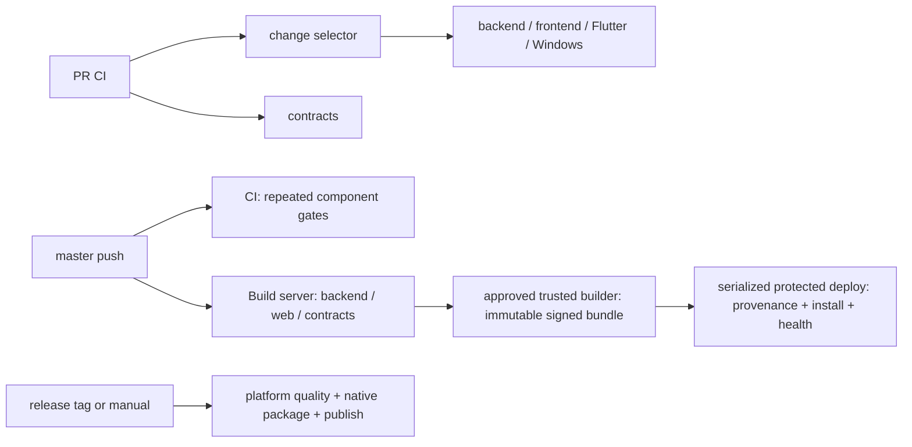

# CI/CD baseline (CICD-01, #383; parent #382)

The collector performs only GETs against Actions metadata in `Egkurilov/BOOHTACORD`.
It never dispatches/reruns workflows, reads logs, downloads artifacts, changes production,
or reads runner credentials. An optional `GITHUB_TOKEN` can increase the public API quota;
use a read-only token. No interactive authentication is needed.

```sh
python3 -m unittest tools.ci.baseline.test_metrics tools.ci.baseline.test_normalize tools.ci.baseline.test_collect tools.ci.baseline.test_report
python3 -m tools.ci.baseline.run \
  --cache .out/ci-baseline/2026-10-18 \
  --output .out/ci-baseline/report \
  --ci-samples 15 --delivery-samples 3 --native-samples 2 --max-requests 60
# Exact recomputation from the frozen sanitized cache, without network:
python3 -m tools.ci.baseline.run \
  --cache .out/ci-baseline/2026-10-18 \
  --output .out/ci-baseline/recomputed \
  --ci-samples 15 --delivery-samples 3 --native-samples 2 --offline
```

The default is 30 per CI cohort, 5 builds/deployments and 3 per native release.
The committed observation deliberately uses 15 PR + 15 master runs (30 combined),
3 builds, 3 deployments, 2 Android and 2 Windows releases. No completed macOS
release runs were available. The smaller per-cohort sample fits the unauthenticated
API quota; p95 for 9 successful PRs is their maximum, not a reliable long-term SLO.
The selected latest completed runs are frozen before collecting jobs. New runs do
not alter a resumed sample. Jobs/artifacts are fully paginated; every run attempt
is read. Missing pages, exhausted quota, transport failure or incomplete offline
cache fail the command. A cached run is written only after complete collection.
Use a fresh cache directory for a new observation or after changing collector schema.

## Replaying the frozen observation after routing changes

`collection.collector_revision` records HEAD at collection start, not a clean tool
source receipt. `analysis_tool_sha256` binds the actual analysis files. The eight
committed reports were reproduced byte-for-byte at analysis revision
`3bf381314f97f0d5570a95ddc08b875917c84431`. Later selector revisions deliberately
have different hashes; use the frozen analysis source when comparing exact bytes.

The committed cohort reports are compact outputs, not the complete offline input
cache. Keep the sanitized input directory for reproducibility. This run's frozen
inputs are available at `.out/issue383/metadata` in the QA workspace. Without those
inputs, exact offline replay is NOT_RUN; a new collection is a new observation.
For that existing workspace (with output outside the temporary worktree):

```sh
git worktree add --detach .out/baseline-analysis 3bf381314f97f0d5570a95ddc08b875917c84431
cd .out/baseline-analysis
python3 -m tools.ci.baseline.run --cache ../issue383/metadata \
  --output ../baseline-replayed --ci-samples 15 --delivery-samples 3 \
  --native-samples 2 --offline
cd ../..
git worktree remove .out/baseline-analysis
```

## Measurements and interpretation

`evidence/ci/baseline-2026-10-18/` contains the sanitized machine-readable observation.
`summary.json` links each cohort to public run URLs; hotspot `run_ids` refer to those
same URLs. Per-cohort files preserve run/job IDs, source SHA, event/ref class,
conclusions, attempt numbers, timestamps, platform, and five costliest steps per job.
All step timing distributions are in the summary; full allowlisted step metadata
stays in the local cache. Tool source SHA-256s identify the exact analysis code,
including the selector used for best-effort changed-component classification.

- Percentiles use nearest rank, independently per cohort, with `n` for every metric.
- Success latency excludes failed/cancelled runs. Failure/cancel/retry rates use all
  sampled completed runs; retry is not proof of a flake. Confirmed flake rate is N/A.
- Wall time is run creation to final active job completion, including waits/retries.
  `updated_at` is not completion. Missing/unfinished active jobs produce nulls.
- Job-minutes sum unique job execution IDs over all attempts. They are occupancy,
  not GitHub billable minutes, monetary cost, or wall time. Skipped jobs cost zero;
  missing active durations make the total unknown. No rounding/OS multiplier is applied.
- First-job delay includes scheduling/setup. Created-to-start may include dependency
  waits/environment approval, so neither is labelled pure runner queue time.
- The completion driver is the last finishing job, not an inferred causal DAG path.
- Metadata does not expose cache hits or cold/warm state. These stay N/A; no logs
  are inspected to guess them. Native release conclusions do not prove device/media QA.
- PR complete-diff components are N/A without a trustworthy base. For locally
  available push heads, first-parent classification is explicitly labelled; it is
  not a substitute for the original push `before` on multi-commit pushes.
- Time-to-required-green is N/A until the required-check policy is explicitly defined
  (#385). Successful CI completion is reported as a labelled proxy, not required-green.
- Delivery timing requires one same-SHA successful build and one exact
  `server-<sha>` artifact. Readiness uses completion of its upload step, not artifact
  creation (which can precede completed upload). Install completion is an upper
  bound for health-readback. Missing/ambiguous links stay N/A. This is observation,
  not a replacement for trusted producer provenance or signed release receipts.

## Observed dependency structure

The current workflow source has these dependencies. Historical timing is linked to
its own run/source SHA; this diagram does not assert unchanged historical workflows.



Use the dated evidence review for measured priorities and provisional budgets.
Do not compare future improvements across different risk/platform cohorts or quietly
remove real acceptance work to reach a time target. Routing, receipts, signing and
production environment approvals remain unchanged by CICD-01.
